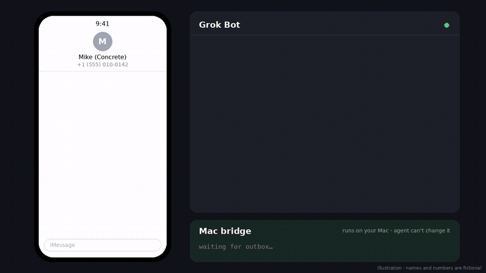

# imessage-agent-bridge

**Let your AI agent text people from your Mac, safely.** Incoming texts go to your agent. Your agent's replies go out through Messages, but only to numbers you approve.

<p align="center"></p>

> ⚠️ **Free, as-is, use at your own risk.** No warranty. You're responsible for every text your agent sends. **Do your own security audit before running it.** The code is short, so read `smsbridge.py` and `outbox/app.py` or have someone you trust review them.

## Get started

You need a Mac signed in to Messages and an AI agent that can browse the web, like Grok Bot.

1. **Tell your agent:**
   > Set up https://github.com/tvykruta/imessage-agent-bridge for me. Follow AGENT_SETUP.md. Only let it text these numbers: …
2. **Do the three things it asks:** paste one Terminal command, turn on Full Disk Access for SMSBridge.app, and click OK on the Messages prompt.

**Pause anytime:** `touch ~/.smsbridge/DISABLED`. **Remove:** `bash uninstall.sh`.

<details><summary>Doing it by hand instead</summary>

1. **Outbox:** click New, then Blueprint on [Render](https://render.com), and point it at this repo. `render.yaml` creates the outbox and its storage and generates `OUTBOX_TOKEN`. Copy the service URL and token.
2. **Mac:** download the ZIP (green **Code** button), then run `bash install.sh` in Terminal.
3. **Settings:** edit `~/.smsbridge/config.json` with your webhook, your outbox URLs (`/outbox` and `/ack`), `Bearer <OUTBOX_TOKEN>`, and your allowlist.
4. **Restart:** `launchctl kickstart -k gui/$(id -u)/com.example.smsbridge`, then turn on Full Disk Access for SMSBridge.app and click OK on the Messages prompt.
</details>

## How it works

```
Texts in:   Messages → your Mac (read-only) → your agent's webhook
Texts out:  your agent → outbox → your Mac checks the rules → Messages
```

## Under the hood

**Inbound (Mac → agent)**
1. Opens `~/Library/Messages/chat.db` **read-only** (`file:...?mode=ro`).
2. Tracks the last seen `message.ROWID` in `~/.smsbridge/state.json`. On first run it starts at `MAX(ROWID)`, so history is never replayed.
3. Every `poll_seconds` (default 15) it selects `ROWID > last`, decodes `text` (or the `attributedBody` NSAttributedString typedstream when `text` is NULL), and appends to a local on-disk queue. It reads at most 200 new messages per poll.
4. Flushes the queue in order with `POST webhook_url` (Bearer auth). On failure, it stops and keeps the rest on disk, retrying with exponential backoff (15s → 300s max).

**Outbound (agent → Mac)**
1. The agent sends `POST /enqueue {id, to, body}` to the outbox service.
2. The Mac polls `GET /outbox`, checks each item against the guardrails, sends it with a fixed AppleScript template through Messages.app (`osascript` with recipient/body passed as argv, never `shell=True`), then sends `POST /ack {id, status: sent|failed|rejected}`.
3. The outbox deletes acked items and remembers the ack for 7 days. Re-enqueueing an acked id returns 409.

**Guardrails (enforced on the Mac, not by the agent)**
- Recipient allowlist (`allowlist`), optionally plus numbers in your Contacts (`allow_contacts`).
- Rate limit: `max_sends_per_hour` (default 30).
- Body cap: `max_body_len` (default 1000).
- Idempotent ids: each outbox id is sent at most once. Repeats are re-acked, never re-sent.
- Kill switch: `touch ~/.smsbridge/DISABLED` or set `"enabled": false`.

## Why it's built to be safe

- **No shell for the agent.** It can only *ask* to send a text. Your Mac decides.
- **Allowlist only.** Numbers not on your list are rejected.
- **Hard limits on the Mac:** 30 texts an hour, 1,000 characters, each text sent once.
- **Read-only history.** It never edits or replays old messages.
- **About 250 lines of plain Python, with no extra packages on the Mac.** Easy to read in one sitting.
- **Security reviewed.** Every finding was fixed. See [SECURITY.md](SECURITY.md).

## Why you should still be careful

- **Agents get tricked.** A malicious text can push your agent to send something bad to an approved number. Keep your allowlist short.
- **Your agent sees every text you get,** including 2FA codes. Only connect an agent you trust.
- **Your outbox token is a password.** Anyone who has it can queue texts.
- **Texts go out as you,** from your number and Apple ID.
- **macOS updates can break it.** This isn't an Apple feature.

## Works with

Tested with **Grok Bot**. It should work with anything that can receive a webhook and send an authenticated POST, but these haven't been tested: Claude Code/Desktop, ChatGPT agents/Codex, OpenClaw, n8n/Zapier/Make, Home Assistant, and LangChain/LangGraph.

- **Inbound:** set `webhook_url` to your agent's webhook.
- **Outbound:** your agent sends `POST /enqueue {"id","to","body"}` with `Authorization: Bearer $OUTBOX_TOKEN`.

## Troubleshooting

- **`authorization denied` on `chat.db`:** SMSBridge.app doesn't have Full Disk Access. Turn it on, then restart (step 6).
- **Nothing sends:** check that `outbox_url` is set, and that `outbox_auth` is `Bearer <OUTBOX_TOKEN>`, not your webhook key.
- **Logs** are in `~/.smsbridge/log.jsonl`, and crashes go to `stderr.log`. The log contains message text, so keep it private.

## For developers

- Outbox environment variables: `REDIS_URL`, `OUTBOX_TOKEN` (at least 24 characters), `PORT`, and `PENDING_TTL`.
- Outbox endpoints: `/healthz`, `/outbox`, `/enqueue`, `/ack` and `/status`.
- All settings are in `config.example.json`. `tz_offset_hours` sets a fixed UTC offset for message timestamps (for example `-5`). Leave it `null` to use the Mac's local time.
- Run the tests with `python3 -m unittest discover tests`.

MIT License · [Security policy](SECURITY.md)
